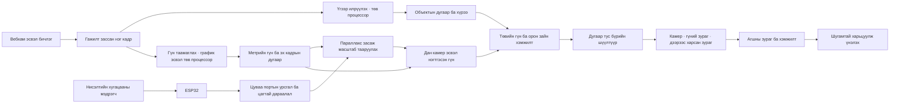

# Системийн архитектур



## Нэг кадрын хугацаа

Үндсэн урсгал дүрсийг уншсан даруйдаа нэг чиглэлд өсөх цагаар тэмдэглэнэ. Калибровкын торыг нягтрал солигдоход нэг удаа байгуулж, дүрсний гажилтыг засна. Хоёр загвар энэ нэг кадрыг хуваалцана. Үндсэн урсгал CPU (төв процессор) дээр YOLO-World (үгээр заасан объектын илрүүлэгч) ба ByteTrack (олон объектын мөрдөгч)-ийг ажиллуулна. Туслах урсгал OpenVINO (Intel-ийн тооцоолол оновчлох орчин)-гоор Depth Anything V2 (ганц дүрсээс гүн олох загвар)-ийг iGPU (нэгдсэн график процессор) дээр ажиллуулна. Хоёр хариуг нэгтгээд дараагийн кадрыг уншдаг тул боловсруулаагүй кадруудын хязгааргүй дараалал үүсэхгүй.

Загвар тус бүр өөрийн гүйцэтгэх хүсэлттэй. Нэг хүсэлт дотроо хариугаа хүлээх зуур нөгөө урсгал үргэлжилнэ. График төхөөрөмжид хөрвүүлэх, эсвэл бодолт хийхэд драйверийн алдаа гарвал гүний загварыг CPU дээр дахин бэлтгэнэ. FP16 (16 битийн хөвөгч таслал) нь хадгалсан жингийн хэлбэр. Ажиллах үеийн бүх үйлдлийн нарийвчлалыг төхөөрөмж ба гүйцэтгэгч сонгоно. [Intel-ийн төхөөрөмжийн заавар](https://docs.openvino.ai/2024/get-started/configurations/configurations-intel-gpu.html)

Гүнийг анхны кадрт, дараа нь `depth_every_n_frames` алхмаар бодно. Завсрын кадрт шинэ хүрээ өмнөх гүнтэй хосолдог тул хурдан хөдөлгөөнд алдаа ихэснэ. Мэдрэгчтэй тааруулалтыг зөвхөн шинээр бодсон гүн дээр хийнэ. Гүний эх кадрын дугаар агшны `depth_frame_index` талбарт үлдэнэ. Хэрэглэгч `P` дарж үгийг солиход урьдчилан хөрвүүлсэн ангиллаас сонгох эсвэл PyTorch (мэдрэлийн сүлжээний сан)-ийн CPU горимд текстийн төлөөллийг шинэчилнэ. Ангилал солигдоход мөрдөлтийн түүх шинээр эхэлнэ.

## Мэдрэгчийн багц

ESP32 (цуваа портоор өгөгдөл дамжуулах микроконтроллер) ба мэдрэгч I2C (хоёр утаст цуваа шугам)-ээр холбогдоно. Хост тал USB Serial (цуваа холболт)-ийг 921600 бод, 8 өгөгдлийн бит, тэгш байдлын шалгалтгүй, нэг төгсгөлийн битээр нээнэ. Төхөөрөмж JSON (түлхүүр ба утга бүхий бичвэр)-оор нэг хэмжилтийг нэг мөрөнд дамжуулна.

```json
{"v":1,"sensor":"VL53L1X","seq":12,"t_ms":780,"mm":[1042],"status":[0]}
```

| Талбар | Утга |
|---|---|
| `v`, `sensor` | Протоколын хувилбар 1. VL53L1X (нэг бүст) эсвэл VL53L5CX (64 бүст) мэдрэгч. |
| `seq`, `t_ms` | Багцын өсөх дугаар, хавтан ассан үеэс өнгөрсөн миллисекунд. Аль аль нь 32 битийн тэмдэггүй бүхэл тоо. |
| `mm` | Миллиметрээр өгсөн нэг эсвэл 64 заалт. Тор нь зураг дээр зүүнээс баруун, дээрээс доош дараалалтай. Модулийн суулгах үеийн эргэлтийг тохиргоонд тусгана. |
| `status` | Бүс бүрийн нэгжсэн төлөв. Тэг нь хүчинтэй. Олон бүст мэдрэгчийн анхны 5 гэсэн төлөв тэг болж, бай илрээгүй тохиолдол 255 болно. |

Уншигч багц задлахдаа урт, төрөл, бүсийн тоо, хувилбарыг шалгана. Цуваа порт болон дүрс авалт өөр цагтай тул багцыг компьютерт ирсэн агшнаар тулгана. Энэ нь тоног төхөөрөмжийн синхрончлолын ойролцоолол. Нэг бүс хүчингүй бол багцыг алгасаж өмнөх коэффициентийг хадгална. Порт тасарсан, эсвэл хамгийн ойрын багц `max_age_s` хугацаанаас хэтэрсэн үед үзүүлэх бодит горим дан камер болно. Бичлэгийг тоглуулахад тухайн агшинд хамааралгүй амьд мэдрэгчийг ашиглахгүй. [Нэг бүст мэдрэгчийн сан](https://github.com/pololu/vl53l1x-arduino) · [Олон бүст мэдрэгчийн гарын авлага](https://www.st.com/resource/en/user_manual/um2884-a-guide-to-using-the-vl53l5cx-multizone-timeofflight-ranging-sensor-with-a-wide-field-of-view-ultra-lite-driver-uld-stmicroelectronics.pdf)

## Гаралт

HUD (камер дээрх хэмжилтийн дэлгэц)-ийн зүүн талд дугаар, ангилал, радиал зай, харагдах өргөн ба өндрийг харуулна. Хоёр биетийн төвүүдийн хоорондох зай босгоос бага бол холбоос улаан болно. Баруун дээд хэсэгт Inferno (хол зайг бараан, ойрын зайг цайвар дүрслэх өнгөний хуваарь)-оор тэнхлэгийн гүнийг үзүүлнэ. Баруун доод BEV (дээрээс харсан дүрслэл)-д оптик тэнхлэг урагш чиглэнэ. Камерын харах хүрээ, метрийн зурвас, бодитоор ашиглаж буй горим, гүний төхөөрөмж ба FPS (секундэд боловсруулсан кадр) харагдана. Агшны PNG (алдагдалгүй зураг) болон JSON ижил суурь нэртэй байна.
